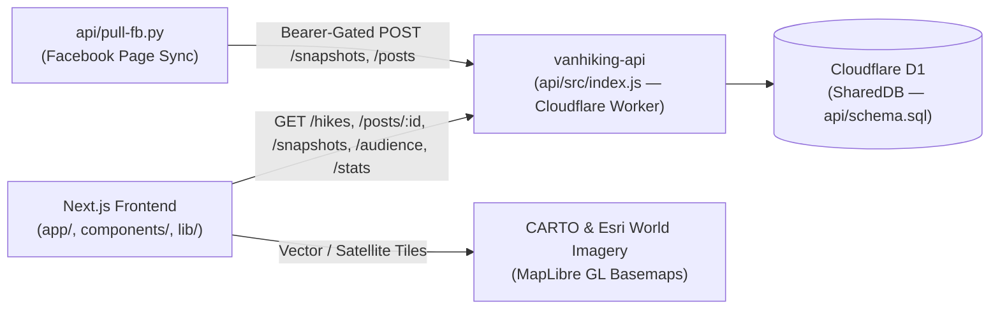

# van-hiking — Evergreen Hiking Club Map & Dashboard

[](https://nextjs.org/)
[](https://react.dev/)
[](https://workers.cloudflare.com/)
[](LICENSE)

[繁體中文](./README.zh-TW.md)

Full-stack route map, analytics dashboard, and Cloudflare Worker API for the **Evergreen Hiking Club (長青健行社)** in Vancouver — archiving every club hike since 2019 with trail geometry, meeting points, estimated distance/duration, and direct links to each outing's Facebook photos and videos.

- **Live Map**: https://vanhiking.vercel.app
- **Analytics Dashboard**: https://vanhiking.vercel.app/dashboard
- **API Docs (Swagger UI)**: https://vanhiking-api.ansung.dev/docs

---

## Features

- **Interactive Route Map**: Plots every walked hike at its meeting point; selecting a pin draws the reconstructed trail route on the map and scrolls to the corresponding hike card.
- **Basemap & Satellite Toggle**: Built on MapLibre GL (`mapcn`) with CARTO basemaps (light/dark theme aware) and Esri World Imagery satellite view.
- **Filtering & Search**: Filter by year, ISO week, or place-name search. Defaults to the last 3 months and paginates 10 hikes at a time.
- **Facebook Post Integration**: Automatically resolves each hike's `post_ids` via `GET /posts/:id` to label and link directly to the day's Facebook photo album or video post.
- **Mobile-First Layout**: Fixed left panel on desktop; draggable Vaul bottom sheet with snap points on mobile.
- **Club Insights Dashboard (`/dashboard`)**: Monthly reach & engagement-rate trend chart (Recharts), post performance feed, and audience demographics.
- **Self-Documenting Worker API (`api/`)**: Cloudflare Worker + D1 (`SharedDB`) with COALESCE upserts, fail-closed Bearer-gated writes, and runtime-generated OpenAPI 3 (`/openapi.json` & `/docs`).

---

## Architecture



### API & D1 Schema (`api/`)

| Table | Purpose |
| --- | --- |
| `social_accounts` | Club account metadata (`fb-changqing`) |
| `social_hikes` | Walked hikes with `geometry`, `meeting_point`, `distance_km`, `est_duration_min`, `post_ids` |
| `social_posts` | Archived Facebook posts (`post_type`, `views`, `engagements`, `reactions`, `shares`, `comment_count`) |
| `social_daily_snapshots` | Daily insights snapshots (aggregated monthly on `/dashboard`) |
| `social_audience` | Audience breakdown by `age`, `gender`, `country`, and `city` |

---

## Project Structure

```text
van-hiking/
├── app/
│   ├── dashboard/
│   │   └── page.js             # Analytics dashboard (/dashboard)
│   ├── globals.css             # Global styles, theme tokens, map pin & selection states
│   ├── layout.js               # Root layout & ThemeProvider
│   └── page.js                 # Landing map, filters, timeline list, mobile drawer
├── components/
│   ├── reui/
│   │   └── timeline.jsx        # ReUI Timeline component
│   ├── ui/                     # shadcn/ui & mapcn primitives
│   ├── header.jsx              # Top navigation bar & theme toggle
│   ├── hike-detail-card.jsx    # Selected hike detail card & Facebook links
│   ├── hike-map.jsx            # MapLibre GL map, pins, animated route, satellite toggle
│   ├── mode-toggle.jsx         # Light / dark theme switcher
│   ├── search-box.jsx          # InputGroup search bar
│   └── theme-provider.jsx      # next-themes wrapper
├── lib/
│   ├── api.js                  # API client & full-pagination helpers
│   ├── hikes.js                # ISO week math, filtering, duration formatting
│   ├── insights.js             # Monthly trend aggregation & audience grouping
│   └── utils.js                # Classname merge helper
├── tests/                      # Node built-in unit tests (node --test)
├── api/                        # Cloudflare Worker backend (vanhiking-api + D1)
│   ├── src/index.js            # Worker routes, COALESCE upserts, OpenAPI 3 generator
│   ├── schema.sql              # D1 database schema
│   ├── wrangler.toml           # Wrangler & D1 binding config
│   ├── pull-fb.py              # Facebook insights/posts sync script
│   └── README.md               # Backend-specific docs & deploy notes
├── .github/workflows/ci.yml    # CI (npm test + npm run build)
├── AGENTS.md                   # Architecture, design rules, and maintainer playbook
└── package.json
```

---

## Quick Start

### Frontend (Next.js)

```bash
git clone https://github.com/dev-ansung/van-hiking.git
cd van-hiking
npm install
npm test
npm run dev
```

Open [http://localhost:3000](http://localhost:3000) in your browser. Production build:

```bash
npm run build
npm run start
```

### Backend (`api/`)

```bash
cd api
npx wrangler deploy
npx wrangler secret put GATE_PASSWORD
```

See [`api/README.md`](./api/README.md) for D1 setup and `pull-fb.py` usage.

---

## Data & Policy Notes

- **Estimated Routes & Times**: Trail geometries are reconstructed using Valhalla pedestrian routing, and estimated durations assume 4 km/h (`distance_km / 4`). Actual walking durations are marked as pending (`待回報`).
- **Historical Archive Only**: The club is closed; only completed hikes are recorded and displayed. Upcoming routes are never published.
- **Maintainer Guide**: See [`AGENTS.md`](./AGENTS.md) for strict UI, data-handling, and verification rules before making changes.
