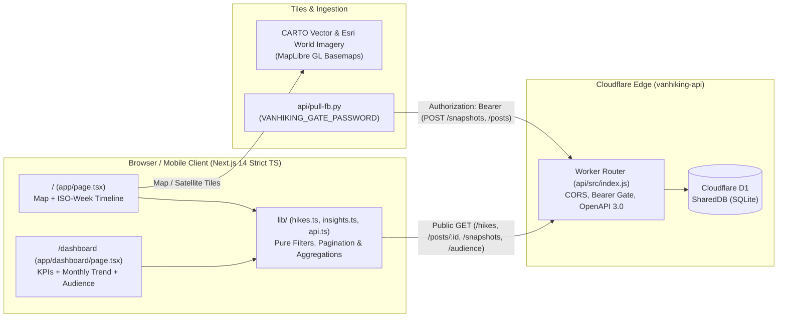
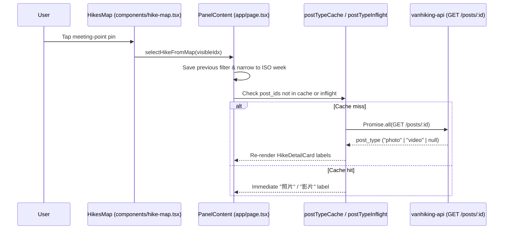

# Technical Architecture — van-hiking

A zero-cost-tier, full-stack geospatial archive and social-insights analytics platform for the **Evergreen Hiking Club (長青健行社, Vancouver)**. It pairs a statically pre-rendered Next.js 14 (strict TypeScript) client with a Cloudflare Worker + D1 SQLite backend, enforcing strict geospatial, time-series, and write-safety invariants.

| Layer | Stack | Key Guarantees |
| --- | --- | --- |
| **Frontend** | Next.js 14 (App Router), React 18, Strict TS, Tailwind v4, shadcn/ui, ReUI | Static edge shells, mobile-first Vaul drawer, `tsc --noEmit` + ESLint |
| **Geospatial** | MapLibre GL (`mapcn`), CARTO, Esri World Imagery, Valhalla pedestrian routing | Unclustered per-hike pins, `requestAnimationFrame` route animation |
| **Backend** | Cloudflare Workers (`vanhiking-api`), D1 (`SharedDB`), OpenAPI 3.0 | Runtime-generated `/openapi.json`, `COALESCE` upserts, fail-closed auth |
| **Verification** | `node --test` (15 tests), ESLint, `tsc --noEmit`, GitHub Actions CI | Domain invariants + Worker auth/validation tested on every PR |

### Key Engineering Decisions (At-a-Glance)

- **Schema-Driven API & Safe Writes**: A single `ENDPOINTS` table in [`api/src/index.js`](api/src/index.js) drives both request routing and runtime `/openapi.json` generation, eliminating doc drift. All writes use `COALESCE` upserts and fail-closed Bearer auth.
- **Geospatial Trade-offs**: Routes use Valhalla pedestrian routing (never OSRM) with `4 km/h` estimated durations; map pins remain unclustered so tapping a pin narrows the list to that hike's ISO week.
- **Time-Series Honesty**: Monthly reach aggregation explicitly excludes the `2026-11-21` `LAST_28D` aggregate row and preserves pre-`2024-08` missing reach as `null` (blank) rather than `0`.

## Contents

1. [System Architecture & Data Flow](#1-system-architecture--data-flow)
2. [D1 Data Model & `COALESCE` Upsert Semantics](#2-d1-data-model--coalesce-upsert-semantics)
3. [Geospatial Pipeline & Map Rendering](#3-geospatial-pipeline--map-rendering)
4. [Time-Series Aggregation & Data Integrity](#4-time-series-aggregation--data-integrity)
5. [Security & Production Failure Modes](#5-security--production-failure-modes)
6. [Type Safety, Testing & CI](#6-type-safety-testing--ci)

---

## 1. System Architecture & Data Flow

The system separates **public, read-heavy edge delivery** (Next.js static shells on Vercel + public `GET` endpoints on Cloudflare Workers) from **Bearer-gated ingestion** (`api/pull-fb.py` and bulk backfill endpoints).

### Client Pagination & Post-Type Resolution

Because D1 queries are capped at `limit=100` per request, [`fetchAllHikes`](lib/api.ts) and [`fetchAllSnapshots`](lib/api.ts) loop with `offset += rows.length` until `all.length >= total` (preventing silent truncation of older hikes or daily snapshots).

When a user selects a hike, [`PanelContent`](app/page.tsx) resolves its `post_ids` asynchronously with a module-level cache (`postTypeCache`) and in-flight deduplication set (`postTypeInflight`) shared between the desktop panel and mobile Vaul drawer:

---

## 2. D1 Data Model & `COALESCE` Upsert Semantics

Defined in [`api/schema.sql`](api/schema.sql), `SharedDB` stores five normalized tables indexed by `(account_id, date/route)`:

| Table | Unique Key | Role |
| --- | --- | --- |
| `social_accounts` | `id` | Club account metadata (`fb-changqing`) |
| `social_hikes` | `(account_id, hike_date, route)` | Walked routes, GeoJSON `geometry`, `waypoints`, `distance_km`, `est_duration_min`, `post_ids` |
| `social_posts` | `(account_id, platform_post_id)` | Facebook posts (`post_type`, `views`, `engagements`, `reactions`, `shares`, `comment_count`) |
| `social_daily_snapshots` | `(account_id, date)` | Daily follower/reach/engagement snapshots |
| `social_audience` | `(account_id, snapshot_date, dimension, segment)` | Age, gender, country, and city breakdowns |

### Partial-Update Safety (`COALESCE` Upserts)

All `POST` handlers in [`api/src/index.js`](api/src/index.js) use `ON CONFLICT(...) DO UPDATE SET col = COALESCE(excluded.col, col)`. Any field omitted from a partial `POST` (e.g., updating `actual_duration_min` or `post_ids` on an existing hike without resending `geometry`) preserves the existing column value in D1 rather than overwriting it with `NULL`.

---

## 3. Geospatial Pipeline & Map Rendering

Implemented in [`components/hike-map.tsx`](components/hike-map.tsx) and [`lib/hikes.ts`](lib/hikes.ts):

- **Pedestrian Routing vs. OSRM**: Trail geometries were reconstructed with Valhalla pedestrian routing rather than OSRM (which snaps to vehicular roads). Estimated durations are computed as `distance_km / 4` km/h and explicitly labeled `估算`; actual durations remain `待回報` until reported.
- **Unclustered Pins with Week Narrowing**: Clustering was intentionally removed. Every hike renders its own meeting-point pin; tapping a pin saves the active `(yearFilter, weekFilter, listLimit)` tuple, narrows the list to that hike's ISO 8601 week (calculated at UTC noon in [`isoYearWeek`](lib/hikes.ts) to prevent timezone boundary drift), and restores the saved filter when cleared.
- **Progressive Route Drawing**: Selecting a hike starts a `requestAnimationFrame` loop (`1000ms–2000ms` scaled by `distance_km`) driving `MapRoute`'s `progress` prop (`0 → 1`) with `RouteMarker` riding the drawing head, while non-selected pins remain visible and muted (`opacity: 0.55`, `grayscale(1)`).
- **Camera Bounds & Single-Pin Guard**: `FlyTo` fits bounds around `[...hikeCoords(selected), ...pinCoords]` with asymmetric padding (`left: 448` on desktop for the fixed panel; `bottom: 180` on mobile for the Vaul peek sheet). When `minLng === maxLng && minLat === maxLat` (a single pin), `fitBounds` is bypassed in favor of `flyTo({ zoom: 13 })` to avoid zooming past CARTO tile coverage.

---

## 4. Time-Series Aggregation & Data Integrity

Implemented in [`lib/insights.ts`](lib/insights.ts) and [`app/dashboard/page.tsx`](app/dashboard/page.tsx):

- **`LAST_28D` Aggregate Exclusion**: Daily snapshots include a `2026-11-21` row representing a 28-day rolling summary (`views: 39,446`) rather than a single day. [`buildMonthlyTrend`](lib/insights.ts) filters out `date === "2026-11-21"` before summing monthly reach so November 2026 is not inflated.
- **Honest Gap Handling (`null` vs. `0`)**: Facebook daily reach insights are only recorded starting `2024-08`, and the club had no posts in 2021. Months between the first and last snapshot with zero recorded reach/engagement emit `views: null` and `engagementRate: null` so Recharts renders gaps rather than misleading zero bars, while still preserving `followers` from the month's latest snapshot.

---

## 5. Security & Production Failure Modes

- **Fail-Closed Bearer Auth**: Write endpoints (`POST` / `DELETE`) in [`api/src/index.js`](api/src/index.js) check `env.GATE_PASSWORD`. If the Worker secret is unset, every write returns `401` rather than failing open.
- **Async `try/catch` (`return await`)**: Every async handler inside `try` in [`api/src/index.js`](api/src/index.js) uses `return await ...` instead of a bare `return promise`. A bare `return` exits the `try` block before the promise settles, letting D1 rejections escape as uncaught Cloudflare `1101` worker exceptions.
- **Cloudflare Bot Fight (`1010`)**: Scripted callers hitting `vanhiking-api.ansung.dev` must send a browser `User-Agent` header; otherwise Cloudflare edge protection returns `1010`.

---

## 6. Type Safety, Testing & CI

- **Strict TypeScript**: [`tsconfig.json`](tsconfig.json) enforces `strict: true` across `app/`, `components/`, and `lib/` with shared domain interfaces in [`lib/types.ts`](lib/types.ts).
- **Zero-Overhead Native Tests (`npm test`)**: Node 22 runs [`tests/`](tests/) directly against `.ts` and Worker `.js` modules via `node --test`:
  - [`tests/hikes.test.mjs`](tests/hikes.test.mjs) — ISO week year-boundary math, duration formatting, `post_type` link labels, and `filterHikes`.
  - [`tests/insights.test.mjs`](tests/insights.test.mjs) — `2026-11-21` `LAST_28D` exclusion, pre-`2024-08` `null` reach preservation, and audience dimension sorting/capping.
  - [`tests/api.test.mjs`](tests/api.test.mjs) — `limit=100` pagination loops until `total` is reached.
  - [`tests/worker.test.mjs`](tests/worker.test.mjs) — Worker `/health`, fail-closed `401` auth, `400` input validation, and `/openapi.json` schema output using a mocked D1 binding.
- **CI Pipeline**: [`.github/workflows/ci.yml`](.github/workflows/ci.yml) runs `npm run lint`, `npm run typecheck`, `npm test`, and `npm run build` on every push and PR to `main`.
